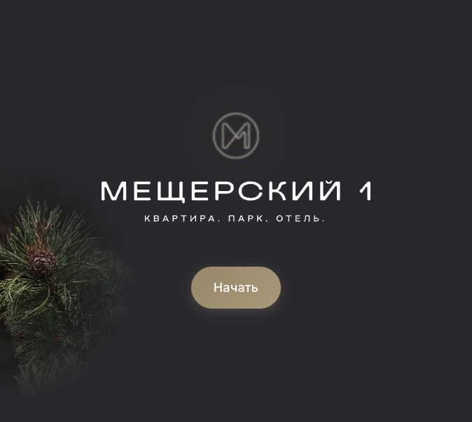
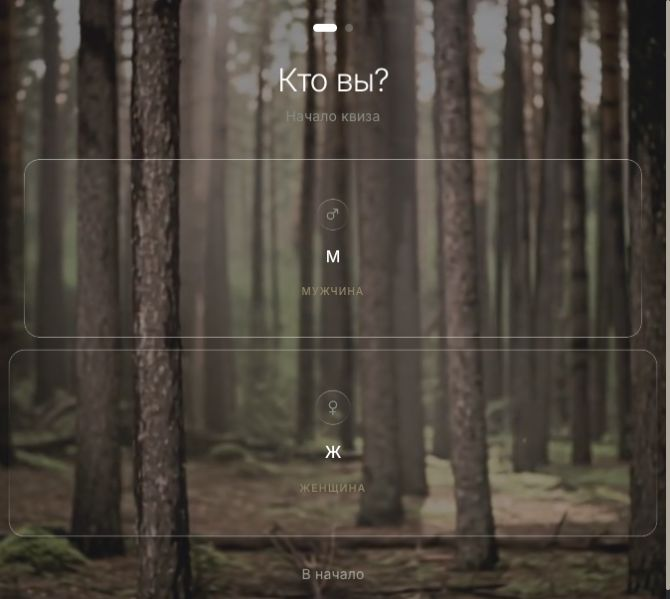
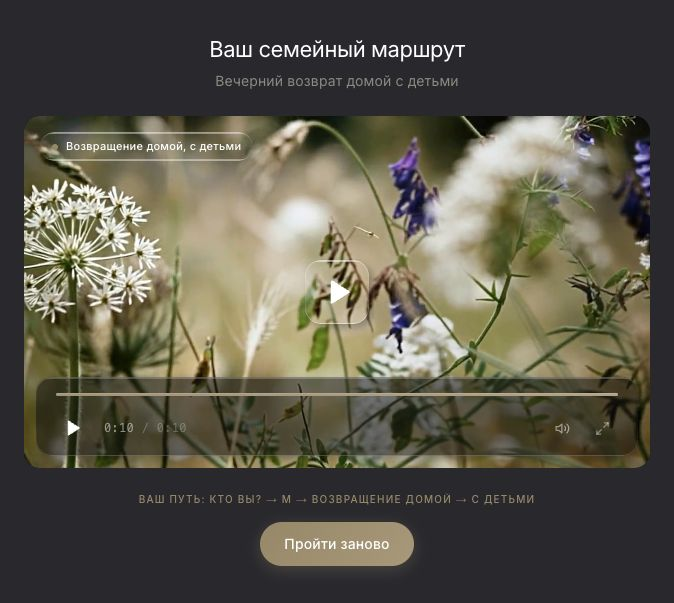
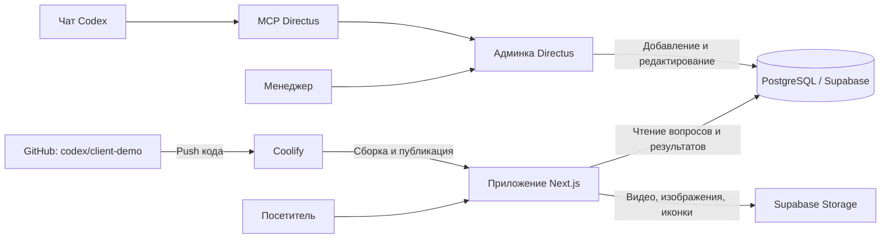
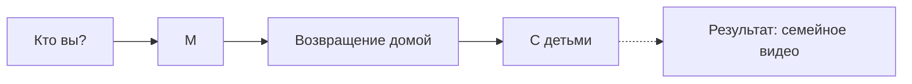
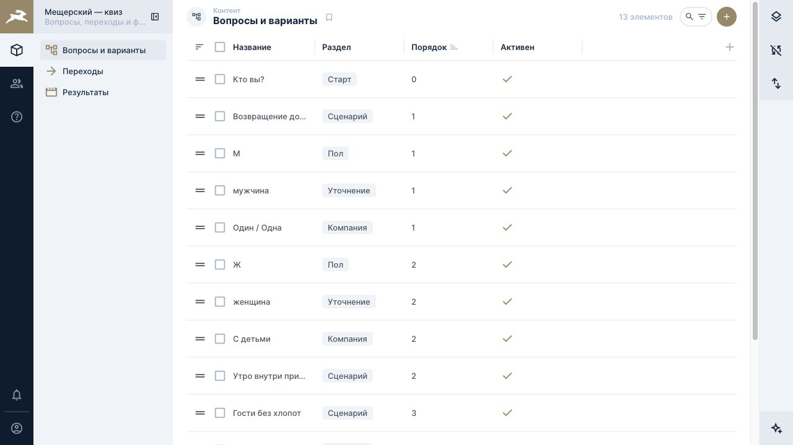
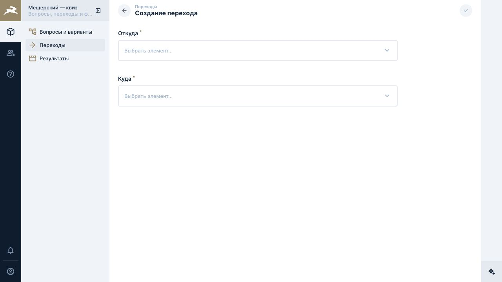
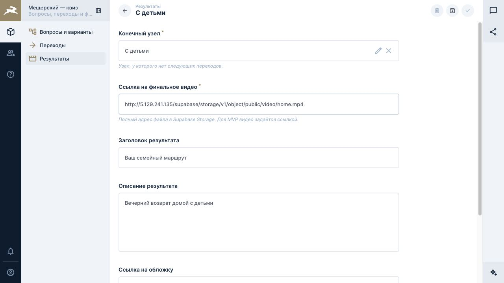

# Мещерский — адаптивный видеоквиз

Посетитель выбирает сценарий и состав компании, а в конце получает видео. Вопросы, варианты и переходы хранятся в базе: новые ветки можно добавлять через **Directus** или **чат с MCP**, без изменения кода приложения.

**[Открыть демо](http://5.129.241.135/)** · **[Открыть Directus](https://directus-w88zoilo7wjotvw7az22l1qr.5.129.241.135.sslip.io/admin/)**

Это руководство относится к текущей демоверсии в ветке **`codex/client-demo`**. Доступ к админке выдаётся отдельно; паролей и ключей в репозитории нет.

## Что видит посетитель

Нажать «Начать» → выбрать ответы → посмотреть видео. Можно вернуться на предыдущий шаг или пройти квиз заново. Прогресс сохраняется в браузере и восстанавливается после перезагрузки страницы.

| Старт | Выбор ответа | Результат |
| --- | --- | --- |
|  |  |  |

## Как устроена система



Directus работает с **той же базой**, которую читает сайт. Изменения контента доступны при следующей загрузке соответствующего шага; для проверки лучше начать квиз заново. Пересборка нужна при изменении кода, а не записей базы. База, медиа, приложение и Directus демоверсии размещены на удалённом сервере.

### Три таблицы квиза

| Таблица | Раздел в Directus | Что хранит |
| --- | --- | --- |
| `quiz_nodes` | **Вопросы и варианты** | Название, описание, раздел, порядок, ссылки на медиа, активность узла |
| `quiz_edges` | **Переходы** | Пару узлов: **Откуда → Куда** |
| `quiz_results` | **Результаты** | Конечный узел, финальное видео, заголовок, описание, обложку и активность результата |

Пример одной ветки:



Каждая сплошная стрелка — отдельная запись `quiz_edges`. Пунктир обозначает привязку `quiz_results.node_id` к конечному узлу, а не ещё один переход. Узел может одновременно быть ответом на предыдущем шаге и заголовком следующего. Один узел можно использовать в нескольких ветках.

Если у выбранного узла нет **активных дочерних вариантов**, приложение открывает финал и ищет активный результат по `node_id`. Поэтому разные пути к одному конечному узлу получают одно и то же видео. Поля `type` и `category` сами по себе не задают переходы.

## Администрирование через Directus

Войдите под выданной учётной записью менеджера. В меню доступны три раздела. Менеджер может добавлять и редактировать контент; удаление записей и изменение структуры базы ему недоступны.



### Добавить новый вариант или ветку

1. В **«Вопросы и варианты»** нажмите **«+»**. Заполните название, при необходимости описание, раздел и порядок. Меньшее значение порядка показывается раньше. Сохраните: новый узел создаётся неактивным — как черновик.
2. В **«Переходы»** нажмите **«+»**. Выберите **«Откуда»** — родительский узел, **«Куда»** — новый вариант. Сохраните. Для нескольких вариантов создайте несколько переходов. Выбирать узлы можно по названиям.
3. Если ветка продолжается, добавьте следующие узлы и переходы. Если узел завершает квиз, в **«Результаты»** создайте запись, выберите **конечный узел**, укажите публичную ссылку на видео, заголовок и описание.
4. Включите результат после проверки видео. Затем включайте готовые узлы **от конца ветки к её началу**: сначала конечный узел, затем его родителей. Неактивные варианты посетителю не показываются.
5. Откройте демо, начните квиз заново и пройдите новую ветку до видео.

Коды и идентификаторы создаются автоматически. Служебные поля результата заполняются автоматически; вручную вводить UUID, slug или хеш пути не нужно.

| Создание перехода | Редактирование результата |
| --- | --- |
|  |  |

### Изменить существующую запись

Откройте нужную строку в списке, исправьте поля и нажмите **галочку сохранения**. Например, название кнопки меняется в «Вопросы и варианты», а финальное видео — в «Результаты». Изменение общего узла затронет все ветки, где он используется.

Чтобы скрыть вариант, выключите **«Активен»**. Система не позволит отключить последний активный вариант действующего родителя, если это оставит маршрут без продолжения. Для перестройки действующей ветки сначала подготовьте полноценную замену.

### Видео и проверка связей

Для MVP медиа задаются **ссылками на публичные файлы в Supabase Storage**. Загрузка через файловую библиотеку Directus не подключена к хранилищу квиза. Сначала загрузите файл в Supabase Storage, затем вставьте его полный URL в нужное поле. Проверьте ссылку в браузере без авторизации.

На демосервере настроены проверки: нельзя создать переход на самого себя, повторить одинаковый переход или замкнуть цикл. Активный результат должен принадлежать конечному узлу. Нельзя публиковать узел без активного продолжения или активного результата. Эти проверки действуют и при работе через MCP.

## Добавление и редактирование через чат — MCP

**MCP** соединяет Codex с Directus: вы описываете задачу обычными словами, а чат читает схему, находит записи и выполняет разрешённые изменения. На настроенном компьютере подключение называется **`directus_quiz`**. После его настройки перезапустите Codex; на другом компьютере подключение нужно настроить отдельно.

### Примеры запросов

> Покажи текущие вопросы, переходы и результаты квиза через Directus MCP. Ничего не меняй.

> Создай неактивный вариант «С друзьями» в разделе «Компания», порядок 4. Свяжи его с «Возвращение домой». Пока не публикуй. Верни ссылки на созданные записи.

> Для узла «С друзьями» добавь неактивный результат: заголовок «Вечер с друзьями», описание «Ваш маршрут для компании», видео — [вставьте полный публичный URL].

> В результате узла «С детьми» измени описание на «Семейный вечер в Мещерском». Видео оставь прежним. Покажи ссылку на изменённую запись.

> Проверь новую ветку «С друзьями»: связи, доступность видео и отсутствие тупиков. Если всё готово, включи результат, затем узел.

При одинаковых названиях укажите родительский узел или ссылку на карточку Directus. После изменения проверьте записи в админке и пройдите маршрут на сайте. Чат выполняет реальные изменения в общей базе; слово **«черновик»** означает, что новый узел или результат должен остаться неактивным.

### Права и подключение

MCP использует отдельного пользователя с правами редактора квиза. В Codex включены инструменты `schema` (чтение схемы), `items` (записи) и `system-prompt` (инструкции Directus). Удаление запрещено; административные инструменты для изменения схемы, пользователей и настроек не включены.

Для подключения на другом компьютере администратор выдаёт отдельный ключ ограниченного пользователя. Конфигурация хранится **локально**, вне Git. Пример для Codex в `~/.codex/config.toml`:

```toml
[mcp_servers.directus_quiz]
url = "https://directus-w88zoilo7wjotvw7az22l1qr.5.129.241.135.sslip.io/mcp"
bearer_token_env_var = "DIRECTUS_MCP_TOKEN"
enabled_tools = ["schema", "items", "system-prompt"]
startup_timeout_sec = 30
tool_timeout_sec = 60
```

`DIRECTUS_MCP_TOKEN` должен быть доступен в окружении процесса Codex. Этот пример показывает способ настройки на новом компьютере; готовое подключение на текущем компьютере уже сохраняет авторизацию локально. Не вставляйте ключ в README, запросы чата или URL. Подробнее: [MCP в Codex](https://developers.openai.com/codex/mcp) и [MCP в Directus](https://directus.com/docs/guides/ai/mcp/installation).

## Разработка и публикация

Стек: **Next.js 16 / React 19 / TypeScript / Tailwind CSS / Framer Motion**, **Supabase PostgreSQL + Storage**, **Directus 11**, **Coolify / Docker / Nginx**. Приложение собирается в статические файлы, а контент запрашивает из Supabase во время работы.

Для локального запуска переключитесь на `codex/client-demo`, установите Bun и создайте `.env.local`:

```dotenv
NEXT_PUBLIC_SUPABASE_URL=http://5.129.241.135/supabase
NEXT_PUBLIC_SUPABASE_ANON_KEY=<публичный anon-ключ удалённого Supabase>
NEXT_PUBLIC_SITE_URL=http://localhost:3000
```

```bash
bun install
bun run dev
# http://localhost:3000

bun run build
# Статическая сборка в out/
```

Публичные переменные встраиваются при сборке. В браузере используется только anon-ключ с правами чтения; серверные пароли, service-role ключ и MCP-токен туда не передаются. Локальная разработка с указанным адресом читает ту же удалённую базу.

Изменения кода публикуются после push в **`codex/client-demo`**: подписанный GitHub webhook уведомляет Coolify, который собирает Docker-образ и обновляет приложение. Приватный репозиторий тоже можно подключить при выдаче Coolify доступа через [GitHub App](https://coolify.io/docs/applications/sources/github/app). Записи, добавленные через Directus или MCP, не требуют push и автодеплоя.

Подробности: [техническое устройство и поля таблиц](docs/architecture.md) · [настройка развёртывания](deploy/README.md).

## Границы MVP

- Медиа пока добавляются ссылками; совместная загрузка в Supabase через Directus не реализована.
- Черновики — отдельные неактивные записи, без отдельной среды предпросмотра и атомарной публикации всей ветки. Изменения активных записей сразу попадают в общую базу.
- Видео выбирается по конечному узлу; отдельный результат для каждого полного пути потребует доработки.
- В ветке «С детьми» временно используется существующее `home.mp4`. В базе есть неподключённый вариант «Пара» с демонстрационными ссылками — его нужно заполнить рабочими медиа перед подключением к квизу.
- Загрузка видео и автоматическое воспроизведение зависят от формата файла и браузера.

Скриншоты сняты с демоверсии. Основной формат руководства — README: он обновляется вместе с проектом; PDF можно выпускать как снимок конкретной версии для передачи клиенту.
